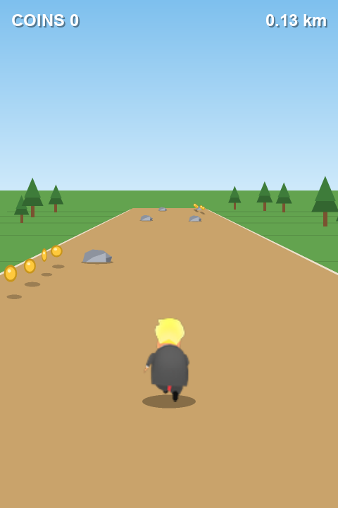
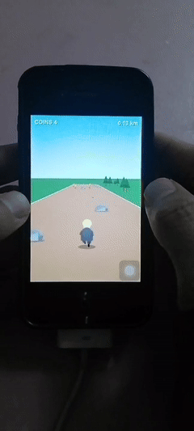

# TrumpGoGo — iPhone 4

A port of the Android game `trumpgogo` (a `SurfaceView` + `android.graphics.Canvas`
runner) to a jailbroken **iPhone 3,1 / iOS 7.1.2**, built from a plain shell with
clang and the iPhoneOS 10.3 SDK — no Xcode project, no Theos, no Gradle.



Tilt the phone to steer, tap to jump, collect coins, do not hit the boulders.
Hitting one freezes the world for 0.9 s, flashes red and resets the run distance.

---

## Build

```sh
./build.sh          # host tests -> assets -> armv7 build -> .app/.ipa/.deb
./push.sh           # install over USB (needs a jailbroken phone + OpenSSH)
```

`build.sh` needs only the Xcode **Command Line Tools**. The SDK is downloaded
into `toolchain/` on the first run (~160 MB, from theos/sdks). Baking the
runtime assets needs Pillow; the baked `.bin` files are checked in, so it is
skipped unless they are missing.

## Install

```sh
./push.sh                    # root password "alpine" by default
./push.sh --password xxxx
./push.sh --probe            # just report what the device is
```

`push.sh` speaks usbmuxd directly over the cable, opens an SSH tunnel to port
22, streams the `.deb` in with `ssh 'cat >'` (the sftp subsystem is unreliable
on old OpenSSH) and runs `dpkg` detached, so a dropped link cannot leave the
package half-installed. Afterwards the icon appears on the home screen.

**Launch it by tapping the icon.** An app started from an SSH shell never
receives the UIKit activation handshake, so `UIApplicationMain` blocks before
`didFinishLaunching` and it will sit on a black screen forever. That is a
property of the OS, not of this build.

## Controls

| Input | Action |
|---|---|
| Tilt left / right | steer (roll about the screen's vertical axis, 40° = full lock) |
| Tap anywhere | jump |
| On-screen stick + button | appears automatically if the accelerometer never delivers a sample |

---

## Why the renderer is a software rasteriser

The first working build drew the whole scene with CoreGraphics every frame, the
way the Android version did with `Canvas`. It produced correct frames and was
unplayable: **~6.4 s per frame** on the A4. Profiling on the device gave the
breakdown (one 640x960 frame):

| stage | cost |
|---|---|
| HUD text (2 strings, drawn twice for the shadow) | 3481 ms |
| Trump sprite blit (one `CGContextDrawImage` at a non-integer scale) | 1298 ms |
| trees / rocks / coins (~40 path fills) | 788 ms |
| sky gradient + grass | 810 ms |

`tools/cgspeed.m` (kept in history, superseded) confirmed the two outliers were
CG's own: a 106x74 sprite blit cost 133–142 ms, and a 640x960
`UIImagePNGRepresentation` took 15.5 s. Every AA path fill carried ~0.3 ms of
fixed overhead before it touched a pixel, which is fatal when the scene needs
~90 of them per frame.

So the game now paints into a **480x720 RGBA buffer** with `src/tgraster.c`, a
small scanline rasteriser: 2 sub-scanlines per row with fractional span ends for
antialiasing, integer 8.8 coverage. `gogo_scene.c` is the scene, ported line by
line from `GogoView.java`; it does not know what a `CGContext` is.

The finished buffer is handed to the GPU as one `CGImage` through
`CALayer.contents` (measured at **0.1 ms** per update, versus ~10 ms to
`CGContextDrawImage` it), and the GPU stretches 480x720 to the 640x960 panel.

### The `-Os` trap

The first software build was still catastrophically slow — 4.8 s for a
full-screen fill, 40 ms for one small ellipse. `tools/fpprobe.c` isolated it:

| build | one full-screen blend |
|---|---|
| `-Os`, blend out of line | **3112 ms** |
| `-Os`, blend inlined by hand | 15 ms |
| `-O2`, blend out of line | 25 ms |

At `-Os` clang refuses to inline the pixel blend, and on this CPU that
out-of-line call costs thousands of cycles per pixel. The project therefore
builds at `-O2` and marks the blend `always_inline`.

### Making it fast enough to play

Inlining removed the cliff but left the game at ~7 fps: **79–142 ms per frame**.
`tools/rsbench_dev.c` (per primitive, minimum of N runs, because SpringBoard
steals cycles) and `tools/stagedev.c` (per stage, one frame at a time) said
where the time actually was, and each row below is one of those measurements:

| fix | before | after |
|---|---|---|
| sprite blit: float bilinear calling `floorf` per pixel → 16.16 fixed point | 3111 ms | 5.4 ms |
| polygon fill: accumulate coverage over the bbox, then blend the row → write the spans straight in | 12–15 ms (road) | 2.3 ms |
| `rs_rect`: opaque backdrops store the word instead of going through coverage | 28.7 ms | 0.93 ms |
| `floorf`/`ceilf` in geometry: out-of-line libm calls → inline int conversions | — | — |
| fully covered runs in the compositor: a word fill instead of a blend per pixel | — | — |

The sprite number is the important one: on this CPU a libm call inside the
inner loop is not a rounding error, it is the whole budget. The fill rewrite is
the second: the old code touched every row five times (clear, accumulate twice,
scan, fill) and the A4 has memory bandwidth for roughly one pass.

What the phone reports now, best of 30 frames at 480x720:

| stage | ms |
|---|---|
| sky gradient | 0.40 |
| grass | 0.56 |
| path planks / grid lines | 0.33 |
| dirt path | 2.32 |
| edge stripes | 1.24 |
| trees, rocks, coins | 4.53 |
| runner sprite | 2.80 |
| HUD | 0.64 |
| **whole frame** | **14.3** |

That is a 70 fps ceiling on an idle phone; under load frames land at 25–45 ms,
and `GoGoView` already drops `frameInterval` to 2 (30 fps) when the average
exceeds 21.5 ms, so it stays smooth instead of tearing.

---

## Layout

```
src/trump_game.{h,c}   world simulation, ported from TrumpGame.java.
                       java.util.Random reproduced bit-exactly (48-bit LCG).
src/test_game.c        host unit tests for the simulation (run by build.sh)
src/tgraster.{h,c}     the software rasteriser: AA polygons, ellipses,
                       gradients, sprite blits, glyph blits, BMP writer
src/gogo_scene.{h,c}   the scene: camera, path, trees, rocks, coins, HUD
src/GoGoView.{h,m}     UIView: frame clock, tilt, touch pads, sound,
                       and pushing finished frames to CALayer.contents
src/AppDelegate.{h,m}  window + root view controller
src/main.m             entry point
src/tglog.{h,c}        file log (/tmp/tg.log, falls back to the sandbox tmp)

tools/gen_assets.py    sprite sheet + font -> assets/*.bin (premultiplied)
tools/hostshot.c       renders reference frames on the build machine
tools/bench_dev.c      on-device: ms/frame + a set of BMP frames
tools/stagedev.c       on-device: one frame at a time with a stage breakdown
tools/rsbench_dev.c    on-device: per-primitive costs, minimum of N
tools/fpprobe.c        on-device: the -Os/float investigation above
tools/ios_launch.m     LaunchServices helper (this device refuses it; kept
                       because it is the correct API on other firmwares)

scripts/               usbmux relay + expect wrappers for the old sshd
```

## Assets

`assets/trumprun.png` is the original 636x296 sheet (6x4 cells of 106x74:
left profile / back / right profile / front). `gen_assets.py` bakes it into
`assets/atlas.bin` — premultiplied 0xAARRGGBB, header `"TGAT"`, w, h — which the
device maps straight into memory, no PNG decoding, no colour-space conversion.
`assets/font.bin` is an 8-bit coverage font (Arial Bold, 24 px em, 34x32 cells,
ASCII 32..126) baked the same way, so the HUD never touches CoreText.

## Measuring on the phone

```sh
./bench.sh --frames 60                  # ms/frame at 480x720 and 320x480
./bench.sh --size 320x480 --frames 120
```

It runs detached (this sshd drops a session after 60 s) and prints the average
frame cost plus the cost with the HUD text disabled. For pictures, the same
binary writes BMPs:

```sh
# on the device, from /tmp/tgb
./bench_dev atlas.bin font.bin 30 480 720 /tmp/tgb/shots
```

A per-stage breakdown is better for finding a regression. Build `stagedev` with
`-DGOGO_PROFILE` and it prints each stage of each frame plus the minimum over
all of them — on a phone shared with SpringBoard, the minimum is the only number
that describes the renderer rather than the scheduler:

```sh
./stagedev atlas.bin font.bin 30
```

The host harness is the quicker loop for anything visual:

```sh
./build.sh && open build/host/*.bmp    # 480x720 frames, identical pixels
```

## Notes

- Screen: 320x480 pt at 2x. The view is portrait-only, status bar hidden, idle
  timer disabled, and it plays nicely with the iPod app
  (`AVAudioSessionCategoryAmbient`).
- The coin sound is the original `coin.wav`, pitched with `AVAudioPlayer.rate`
  so repeated pickups do not sound identical.
- The package is pseudo-signed with `ldid -S`; AppSync (or any jailbreak that
  accepts ad-hoc signatures) installs it. There is no developer certificate
  anywhere in this repository.
- 480x720 is deliberate: 240x360 is 44% of the pixels but looks blocky at 2.67x,
  and 640x960 costs 1.8x more fill for no visible gain over a 1.33x GPU
  upscale.

---

# Lessons learned

A retrospective, with the numbers that produced each one. Everything here was
found on the device or in a rendered frame — none of it was visible from
reading the source.

The three defects reported after the first install are a fair sample of the
whole port:

| symptom | actual cause | lesson |
|---|---|---|
| trees had no left half, crown looked detached from the trunk | `drawTri` ported as a one-sided triangle | 4 |
| `km` counter never reached the right margin, `loading...` sat left of centre | the text pen advanced in the wrong unit | 3 |

(The third complaint, that the splash read as a dead screen, was not a defect —
pure `#000000` on an IPS panel looks switched off, so it is `#101014` now.)

## 1. Profile on the target, never on the desktop

The host build renders a frame in **5.1 ms**; the phone took **6.4 s** for the
same code. A 1200x gap. Had the port been tuned against the Mac build it would
have shipped "fast" and been unplayable. Every optimisation in this project was
driven by a number printed on the device, and half of them were nowhere near
where intuition pointed (HUD text was 3481 ms of a 6400 ms frame).

## 2. A 1000x slowdown is usually a calling convention, not an algorithm

`-Os` cost 3112 ms for one full-screen fill; `-O2` cost 25 ms for the *same*
C. The blend was not being inlined, and on an A4 an out-of-line call in the
inner loop is thousands of cycles — more than the pixel work it wraps.

Same shape of bug twice more: `floorf()` inside the bilinear loop (3111 ms vs
5.4 ms in fixed point), and `__sincosf_stret` inside every ellipse. **On a
32-bit ARM device, look for the call before you look for the algorithm.**

The companion rule is memory bandwidth. The old polygon filler cleared the
coverage buffer, accumulated two sub-scanlines into it, scanned it, then blended
the row — five passes over the same line, and the A4 only has room for about
one. Writing the spans straight into the frame took the road from 12–15 ms to
2.3 ms without changing a pixel. On this hardware, "how many times do I touch
this row" is a first-order cost, not a micro-optimisation.

## 3. Two units in one function is a bug

`rs_text()` took `x` in scene units, multiplied it by the raster scale, then
advanced the pen by `adv[]` — which is in *device* pixels, because glyph cells
are baked at final size and blitted 1:1. Result: every string drew at half its
real width. The visible symptoms were two unrelated-looking complaints — the
`km` counter not reaching the right margin, and `loading...` sitting 55 px left
of centre — from one missing multiplication.

The fix was to pick a side: **positions go through the scale, advances and
alignment do not**. Written down in `tgraster.h` so the next caller cannot get
it wrong:

```c
/* Width in device pixels, i.e. what the pen actually covers. */
float rs_text_width(const TGFont *f, const char *s);
```

## 4. Port the expression, not the result

`drawTri(cx, baseY, w, h)` builds a triangle from `cx - w/2` to `cx + w/2` with
the apex at `cx`. The port wrote `rs_tri(sx, baseY, sx + w * 0.33f, baseY, ...)`
— it had reasoned about *where the vertices end up* and dropped the left one.
The tree shipped as a right triangle: the crown's whole left half missing, and
because the remaining half sat to the right of the centred trunk, it also
looked detached.

A porting bug like this is invisible in the source (the numbers look
plausible), obvious in a screenshot, and trivial once found — which is the
argument for **looking at rendered output after every porting session**, not
only at the diff.

## 5. Verify alignment in pixels, not by eye

"Looks centred" is not a measurement. Ten lines of Pillow beat squinting:

```python
cols = [x for x in range(480) if any(min(px[x, y]) > 200 for y in range(500, 560))]
print(min(cols), max(cols), (min(cols) + max(cols)) // 2)   # ink span and centre
```

The threshold matters: at `> 60` the faint splash spotlight was being counted as
text ink and every reading was wrong. Measure the ink (near-white), not the
neighbourhood.

## 6. Keep a golden frame

`build/host_ref/` holds the first known-good render of all seven states. After
every rasteriser change the harness re-renders and the diff is compared
pixel-by-pixel. That is how the span-based polygon filler was proven to be
**bit-identical** to the coverage-buffer version it replaced — a rewrite of the
hottest path in the renderer, with zero visual risk, because the check was
mechanical rather than visual.

## 7. On a loaded phone, only the minimum is a measurement

Load average sits at 12 on a single core; a single frame can read 40x its true
cost. `bench_dev` averages, `stagedev` and `rsbench_dev` report the minimum of
N, and the minimum is the only number that describes the renderer instead of
the scheduler. Two early "regressions" were SpringBoard, not code.

## 8. The install is not finished until you read the result back

`dpkg` runs detached and ends with `killall -9 SpringBoard`; the respring
routinely kills the SSH session, so `push.sh` can time out *after* a perfectly
good install (or, worse, leave you unsure). The device-side log survives in
`/tmp/dpkg.out` — read it on the next connection rather than re-running the
install. If sshd itself stops answering for minutes afterwards, the phone is
still alive on USB; it recovers, or a reboot fixes it.

And the one thing no amount of automation solves on this firmware: **an app
`exec`'d from a root shell never receives the UIKit activation handshake**, so
it must be launched by tapping the icon. Every on-device measurement in this
repo therefore lives in a pure-C probe, not in the app.

## 9. Four small facts that each cost an hour

| fact | consequence |
|---|---|
| `clock_gettime` is iOS 10+ | the first probe died on launch: `dyld: Symbol not found: _clock_gettime`. Use `gettimeofday`, even in 2013-era code. |
| macOS has no `timeout` | it is GNU coreutils (`gtimeout` on brew). The command silently "not found" and looks like the device failed. |
| zsh does not word-split variables | `FLAGS="-arch armv7 ..."; clang $FLAGS` passes one giant argument. Use an array: `FLAGS=(...); clang "${FLAGS[@]}"`. |
| this sshd drops the session at 60 s | a probe that prints nothing is usually a dead session, not a dead program. `setvbuf(stdout, NULL, _IONBF, 0)` plus `nohup … & touch done.flag` and polling for the flag is the only reliable pattern. |

None of these are about the game; all of them cost more time than the game's
trickiest maths.


